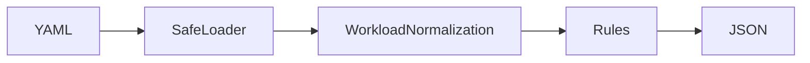

# Kube Manifest Guard

Офлайн CLI для проверки Kubernetes-манифестов перед деплоем. JSON-отчёт и ненулевой exit code позволяют использовать его как шаг CI.

Проверяет host namespaces, hostPath, запуск от root, privileged mode, privilege escalation, read-only root filesystem, requests/limits и закрепление образа по digest. Поддерживает Pod, Deployment, StatefulSet, DaemonSet, ReplicaSet, Job, CronJob, List и несколько YAML-документов.

## Запуск

Python 3.11+; команды выполняются из корня репозитория.

```bash
python3 -m venv .venv
source .venv/bin/activate
python -m pip install -e '.[dev]'
pytest -q
ruff check .
```

```bash
kube-guard examples/good.yaml
kube-guard examples/risky.yaml  # ожидаемый exit code 1
```

Exit codes: 0 — замечаний нет; 1 — есть нарушения; 2 — ошибка входных данных.

## Как устроено



Правила отделены от чтения файлов: `audit()` можно встроить в другой инструмент. Pod-level runAsNonRoot учитывается вместе с переопределением контейнера; init и ephemeral containers также проверяются.

## Границы и развитие

Это небольшой набор собственных правил, а не полная реализация Pod Security Standards. Не проверяет API schema, RBAC, NetworkPolicy, подписи образов и реальные настройки кластера. Не рендерит Helm. Для Helm сначала используйте `helm template`. Наличие digest проверяется как политика закрепления, без обращения к registry. Успешная проверка не означает, что манифест валиден или безопасен по всем критериям.

Следующие задачи: SARIF, конфигурация severity, дополнительные правила capabilities/seccomp, schema validation. В тестах есть наследование securityContext, init containers, CronJob и multi-document YAML.

Основание для правил: [Kubernetes Pod Security Standards](https://kubernetes.io/docs/concepts/security/pod-security-standards/).
